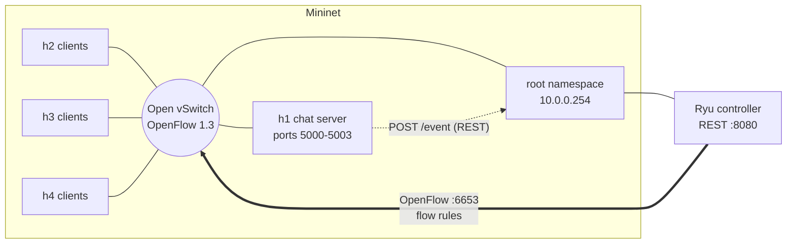
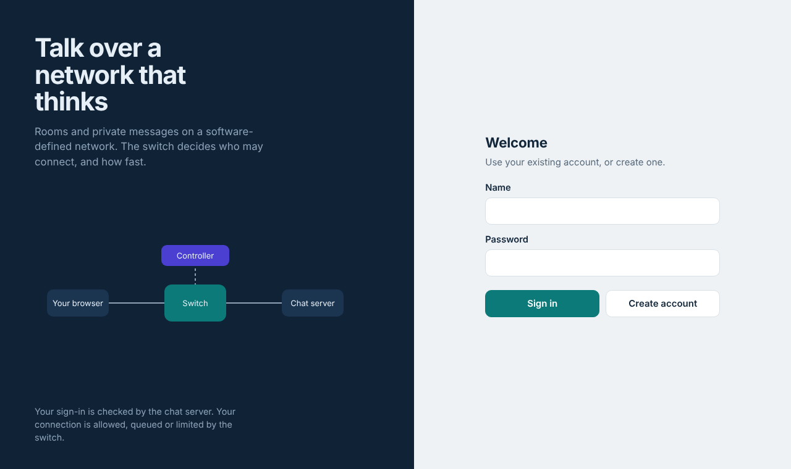
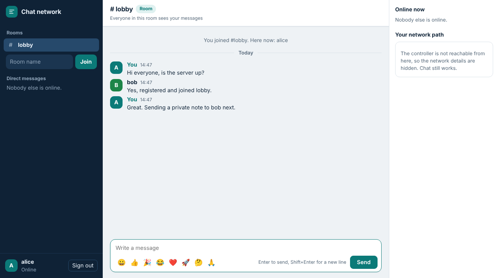
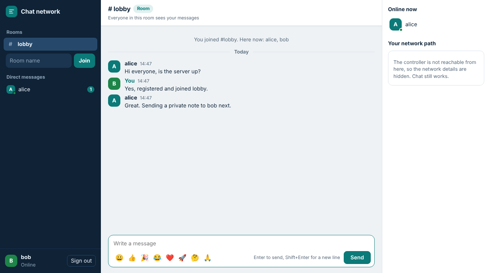

# Multi-Client Chat Network over SDN

A multi-client chat application built on plain TCP sockets, running on a Mininet network that a Ryu SDN
controller programs over OpenFlow 1.3. The chat server reports what users do (register, join, leave, spam,
failed logins) to the controller, and the controller turns that into rules on the switch. So the network
itself decides who may chat, how their traffic is classified, and, in the second deliverable, how it is
rate-limited and rerouted.

Course: Computer Networks (UE25CS243A), SDN and socket programming mini project. Team: Janhvi, Keerthan, Harsha.

## Contents

- [Objectives](#objectives)
- [What it does](#what-it-does)
- [Architecture](#architecture)
- [Screenshots](#screenshots)
- [Demo video](#demo-video)
- [Setup](#setup)
- [Running the demo](#running-the-demo)
- [Tests](#tests)
- [Team and contributions](#team-and-contributions)
- [Repository layout](#repository-layout)
- [Documentation](#documentation)
- [Troubleshooting](#troubleshooting)
- [Status and known limits](#status-and-known-limits)

## Objectives

1. Build a multi-client chat application with concurrent TCP clients, user registration, chat rooms,
   private messaging and many simultaneous connections.
2. Run it on a Mininet network controlled by an SDN controller, and classify chat traffic with flow rules.
3. Apply user and room policies from application events (registration, rooms, spam, brute force).
4. Measure scalability and response time against a static baseline controller (deliverable 2).

## What it does

**Chat application** (`chat/`)
- Threaded TCP server on four ports, one per traffic class: 5000 control, 5001 room chat, 5002 private
  messages, 5003 bulk.
- Registration and login with hashed passwords, rooms (created on first join), private messages, and
  user and room listings.
- Messages are a 4-byte length followed by JSON, so message boundaries survive TCP's byte stream.
- Spam detection (about 20 messages in 5 seconds flags a user) and brute-force detection (5 bad logins).
- Command-line client, load-generating bots, and a browser client (`make web-chat`).

**SDN controller** (`controller/`, Ryu, OpenFlow 1.3)
- Receives chat events over REST (`POST /event`) and keeps them as state; rules are derived from that state.
- Gating: chat ports 5001 to 5003 are dropped for hosts that have not registered; the control port 5000
  always stays open so a new user can register.
- Classification: registered hosts get allow rules that place port 5001, 5002 and 5003 traffic in different
  queues (normal, high and bulk).
- Rules are removed when the user disconnects, using strict deletes so the default rules are never touched.
- Also implemented for deliverable 2: VIP queue, spam throttling with meters, brute-force block,
  congestion response, link-failure rerouting on a triangle of switches, and a baseline mode.
- REST API: `/event`, `/health`, `/state`, `/metrics`, `/policy`.

**Dashboard and web chat** (see [`docs/ui.md`](docs/ui.md))
- A live dashboard served by the controller at `http://<controller>:8080/ui`: network map coloured by policy,
  server-link load, hosts and rooms, and a plain-English event feed.
- A browser chat client whose "Your network path" card shows what the controller is doing to your host.

## Architecture



How one registration works:

1. The client connects to port 5000, which is always open, and sends `REGISTER`.
2. The server creates the account and, before replying, posts a `register` event to the controller and waits.
3. The controller records the user and installs three allow rules for that host (one per chat port).
4. The server replies, the client opens ports 5001 and 5002, and they now pass the gate.

The flow table has two stages. Table 0 is policy (drop, allow, classify) and table 1 is routing, so the two
never need to know about each other. Flow priorities: 100 drop chat ports, 150 allow control port, 200 allow
registered host, 250 VIP, 300 throttle, 400 block.

Full design: [`docs/architecture.md`](docs/architecture.md), the wire and event contract:
[`docs/interfaces.md`](docs/interfaces.md), and the controller: [`docs/controller.md`](docs/controller.md).

## Screenshots

| | |
|---|---|
|  |  |
| Browser chat: sign in | Browser chat: room conversation, rooms and people |



More screenshots (dashboard, switch flow tables, test output) live in [`docs/screenshots/`](docs/screenshots/).
The shots above are from the real chat server and browser client; the "network path" panel says the
controller is unreachable because they were taken without the SDN network running.

## Demo video

Link: _to be added before deliverable 2_

## Setup

Tested on an Ubuntu 22.04 or 24.04 VM. Mininet and Open vSwitch only run on Linux (they need network
namespaces), so use a Linux VM; they cannot run natively on macOS or Windows.

### 1. Mininet, Open vSwitch and tools

```bash
sudo apt update
sudo apt install -y mininet openvswitch-switch git curl python3-pip python3-venv iperf3
sudo systemctl enable --now openvswitch-switch
sudo mn --test pingall          # expect: 0% dropped
```

### 2. Ryu (needs Python 3.9)

Ryu 4.34 does not install on Python 3.10 and later, so it runs in its own environment. It talks to Mininet
only over OpenFlow, so the two Python versions do not need to match.

```bash
curl -LsSf https://astral.sh/uv/install.sh | sh
source ~/.local/bin/env
uv venv --seed --python 3.9 ~/ryu-env
~/ryu-env/bin/pip install -U "pip<24.1" "setuptools==57.5.0" wheel
~/ryu-env/bin/pip install "eventlet==0.30.2" "dnspython<2"
~/ryu-env/bin/pip install ryu==4.34 --no-build-isolation
~/ryu-env/bin/ryu-manager --version      # expect: ryu-manager 4.34
```

### 3. This repository

```bash
git clone https://github.com/Keerthan-S-Kumar/CN-SDN-Multi-Client-Chat-Network-Mini-Project.git
cd CN-SDN-Multi-Client-Chat-Network-Mini-Project
```

## Running the demo

Always start in this order, in separate terminals, from the repository root.
**`sudo mn -c` also kills `ryu-manager`, so run it first and never while the controller is running.**

```bash
# Terminal 1: clean up, then start the controller
sudo mn -c
rm -f eval/results/*.jsonl                    # clears the old dashboard feed
source ~/ryu-env/bin/activate
export PYTHONPATH=.
ryu-manager controller/app.py                 # SDN mode (default)

# Terminal 2: the network (single switch for deliverable 1)
sudo env PYTHONPATH=. python3 topology/topo.py --topo single --cli
```

At the `mininet>` prompt:

```
mininet> pingall                                         # 0% dropped
mininet> h1 curl -s http://10.0.0.254:8080/health        # {"ok": true}
mininet> h1 PYTHONPATH=. python3 chat/server.py --host 10.0.0.1 > /tmp/server.log 2>&1 &
mininet> h2 python3 -c "import socket; socket.create_connection(('10.0.0.1',5001),timeout=3)"
         # times out: the switch drops chat traffic from an unregistered host
mininet> h2 sh -c "(printf '/join lobby\n'; sleep 120) | PYTHONPATH=. python3 chat/client.py --server 10.0.0.1 --user bob" > /tmp/bob.out 2>&1 &
```

In a third terminal, inspect the switch and the controller:

```bash
sudo ovs-ofctl -O OpenFlow13 dump-flows s1 table=0 | grep 10.0.0.2   # three priority-200 rules for bob
curl -s localhost:8080/state                                         # bob and the room lobby
```

Open the dashboard at `http://127.0.0.1:8080/ui` to watch the same thing live. For the browser chat run
`make web-chat` (or start `chat/web_gateway.py` on a Mininet host) and open `http://localhost:8000`.

Useful targets: `make flows`, `make meters`, `make queues`, `make metrics`, `make server`.

## Tests

```bash
make test         # 20 controller tests (real OpenFlow messages, fake switches); needs Ryu importable
make test-chat    # chat server and web gateway tests (real sockets, fake controller)
sudo mn -c        # then, with a controller running:
sudo env PYTHONPATH=. python3 -m unittest tests.test_topology -v     # single topology
sudo env PYTHONPATH=. python3 -m unittest tests.test_triangle -v     # triangle ports and QoS queues
bash controller/verify_live.sh                                       # live rule checks against Open vSwitch
```

`controller/verify_live.sh` posts fake chat events and checks that the matching OpenFlow rules appear and
disappear on every switch.

## Team and contributions

| Member | Contributions |
|---|---|
| **Janhvi** | Chat application: threaded TCP server (registration, login, rooms, private messages, bulk port), command-line client, load-generating bots, spam and brute-force detection, result analysis and plotting scripts, and the 43-test chat server suite. Part A documentation (`docs/part-a.md`). |
| **Keerthan** | SDN controller: the Ryu application (flow rules, two-table pipeline, routing, policy, congestion monitor, REST API), its 22 unit tests and live verification script, the live dashboard and the browser chat client, the frozen interface contract, and repository administration (branching, reviews, CODEOWNERS). |
| **Harsha** | Network: Mininet topologies (single switch and triangle), the root-namespace link to the controller, Open vSwitch QoS queues, topology and triangle tests, and the architecture document. |

Ownership rules and the per-deliverable split are in [`docs/ownership.md`](docs/ownership.md).

## Repository layout

```
chat/        TCP chat server, client, bots, spam detector, web gateway and page, wire protocol
controller/  Ryu OpenFlow 1.3 app, REST API, dashboard, unit tests, live verification script
topology/    Mininet topologies (single, triangle) and Open vSwitch QoS queues
common/      constants shared by everyone (ports, IPs, priorities, queues, thresholds)
tests/       automated tests (chat server, web gateway, topology)
eval/        experiment runner, analysis and plotting (deliverable 2)
tools/       mock controller, fake event sender, repository helpers
docs/        architecture, interface contract, controller notes, evaluation plan, screenshots
```

## Documentation

| Doc | What it covers |
|---|---|
| [`docs/architecture.md`](docs/architecture.md) | Components, topologies, flow-table design, dynamic behaviour |
| [`docs/interfaces.md`](docs/interfaces.md) | The frozen contract: ports, message formats, events, flow rows |
| [`docs/controller.md`](docs/controller.md) | The controller: design decisions, flow table, test cases and rubric map |
| [`docs/part-a.md`](docs/part-a.md) | Chat server, client, bots, spam detection, analysis scripts |
| [`docs/ui.md`](docs/ui.md) | Live SDN dashboard and browser chat client |
| [`docs/eval-plan.md`](docs/eval-plan.md) | Scenarios, metrics and result formats for deliverable 2 |
| [`docs/ownership.md`](docs/ownership.md) | Who owns which files and the task split |

## Troubleshooting

| Symptom | Cause and fix |
|---|---|
| `Unable to contact the remote controller at 127.0.0.1:6653` | The controller is not running, or `sudo mn -c` killed it. Clean up first, then start the controller, then the topology. |
| `ModuleNotFoundError: No module named 'common'` | Run from the repository root and set `PYTHONPATH=.` (as `export PYTHONPATH=.`). |
| Copied commands break at underscores | Some viewers split copied text. Type the command, or use `export` on its own line. |
| Ryu listens on the wrong port | Ryu 4.x uses OpenFlow port **6653**, not 6633. |
| `sudo` rejects the right password after pasting commands | A pasted multi-line block fed later lines into the password prompt. Run `sudo -v` first. |
| Dashboard shows events from an earlier run | Delete `eval/results/*.jsonl` before starting the controller, then refresh the page. |
| Ping fails on the `triangle` with a plain learning switch | The triangle has a loop; use the project controller, which routes loop-free. |

## Status and known limits

- **Deliverable 1** (single switch, gating, classification, socket to SDN integration, dashboard) is built and
  documented. Its demonstration runs live on a Mininet VM.
- **Deliverable 2** features (queues, meters, spam throttling, congestion response, link-failure reroute,
  baseline comparison, scalability measurements) are implemented in the controller and topology code and are
  covered by unit tests; the experiment runner (`eval/run_experiments.py`) and the final measurements are
  still in progress.
- Policy is per host IP, not per user or room: one TCP connection carries all of a user's rooms, and users
  on the same host share its rules.
- The controller is a single process with no failover, and routing is shortest-path, not load-aware.
