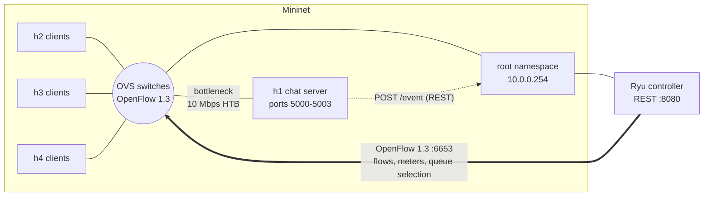
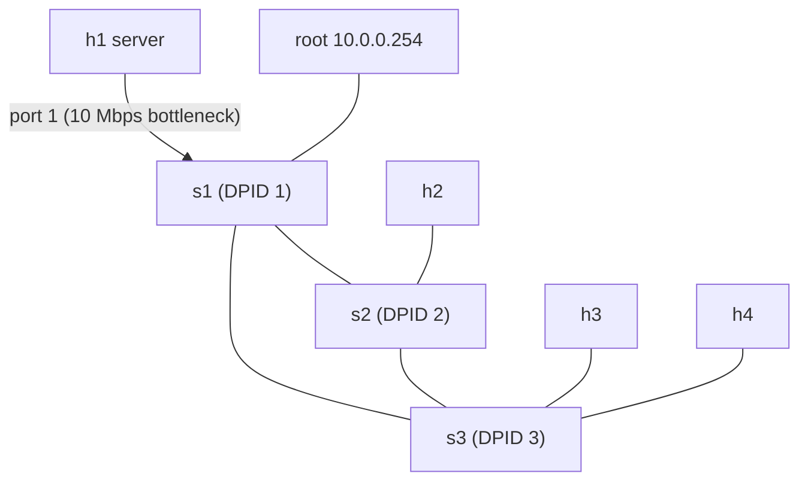
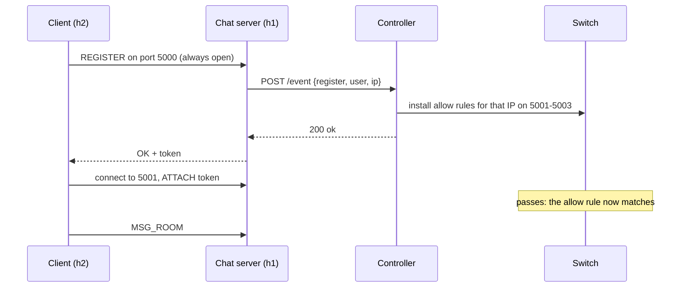

# Architecture

This document explains how the multi-client chat network is put together: the components, how a chat
event turns into network behaviour, and what the SDN controller does and why. The exact message
formats, ports and flow-table rows are frozen in [`interfaces.md`](interfaces.md); this file explains
the design. If the two ever disagree, `interfaces.md` wins.

## 1. Goal

Build a multi-client chat application on TCP sockets (registration, rooms, private messages) and run it
on an SDN-controlled Mininet network. The controller does not just forward packets: it **classifies chat
traffic, applies per-user and per-room policy, and reacts to application and network conditions**
(congestion, spam, unauthorised access, brute force, link failure). The project compares this
`sdn` controller against a static `baseline` that only forwards.

## 2. Components

| Component | What it does | Owner |
|---|---|---|
| Chat server (`chat/server.py`) | Threaded TCP server on ports 5000-5003 on `h1`. Handles registration, login, rooms, private messages and bulk transfer. Tells the controller about every user event. | A |
| Chat client and bots (`chat/client.py`, `chat/bot.py`) | Interactive client, and load-generating bots for the experiments. | A |
| Ryu controller (`controller/`) | Installs and removes flow rules from the events it receives, routes traffic, monitors the bottleneck, and exposes a REST API. | B |
| Topology and QoS (`topology/`) | Builds the Mininet network and configures the HTB queues on the bottleneck port. | C |
| Tests and experiments (`tests/`, `eval/run_experiments.py`) | Verify behaviour and generate the measurements. | C |
| Analysis (`eval/analyze.py`, `eval/plot.py`) | Turn experiment CSVs into summary tables and graphs. | A |

### Why the controller runs outside Mininet

The Ryu process runs on the VM, not inside a Mininet host. A **root-namespace interface** `10.0.0.254`
is linked to `s1`, so the chat server on `h1` can reach the controller's REST API through the real
simulated network, and OpenFlow runs separately over `127.0.0.1:6653`.

## 3. Topologies

**`single` (D1)** has one switch `s1` with `h1` (server) on port 1, `h2` to `h4` on ports 2 to 4, and the
root interface on port 5. It is used for the basic functionality and the gating tests.

**`triangle` (D2)** has three switches in a loop, so a failed link has an alternative path:

All switch-to-switch and client links are 100 Mbps. Only `s1` port 1 (toward the server) is limited to
10 Mbps, and that link is the **shared bottleneck** for all client-to-server traffic. That is deliberate:
it makes congestion easy to create, and queue priority at that point is what the controller exploits.

## 4. Traffic classes

The server uses one TCP port per kind of traffic, so the network can classify packets by destination
port alone.

| Port | Class | Gated? | Queue |
|---|---|---|---|
| 5000 | Control: register, login, join, list | No, always open | High |
| 5001 | Room chat | Yes | Normal |
| 5002 | Private messages | Yes | High |
| 5003 | Bulk transfer | Yes | Bulk |

"Gated" means the network drops this traffic from any source IP that has not registered. Port 5000 is
never gated, because a new user has to reach the server in order to register.

## 5. How an application event changes the network

Example: a new user registers and then chats.

The server waits for the controller's reply before answering the client. This guarantees the allow rule
exists before the client opens its chat connections, so the first message is never dropped.

## 6. Flow-table design

The switch uses two tables. Table 0 is **policy**, and table 1 is **routing**.

| Priority (table 0) | Matches | Does |
|---|---|---|
| 400 | Source is a blocked IP | Drop |
| 300 | Source is a flagged (spamming) IP | Meter to a low rate, send to the Bulk queue |
| 250 | VIP user, room-chat port | Send to the High queue |
| 200 | Source is a registered IP, chat ports | Send to the queue for that port |
| 150 | Control port 5000 | High queue |
| 100 | Any chat port 5001 to 5003 | Drop (this is the gating rule) |
| 60 | Heavy sender during congestion | Meter and Other queue |
| 0 | Everything | Go to the routing table |

Higher priority wins, so a rule for a registered user (200) beats the default drop (100), and a block
(400) beats everything. Table 1 forwards by destination MAC along the shortest path.

In `baseline` mode only the priority-0 rows exist: no gating, no queues, no meters, and no reaction.

## 7. Dynamic behaviour

| Condition | How the controller notices | What it does | When it undoes it |
|---|---|---|---|
| Unauthorised access | Unregistered IP tries ports 5001-5003 | Drops the packets and counts the hits | Immediately, once the user registers |
| Congestion | Bottleneck throughput stays above the on-threshold for consecutive samples | Finds the heaviest sender and meters it | When utilisation falls below the off-threshold |
| Spam | The server reports a `flag` event | Throttles that IP | On an `unflag` event |
| Brute-force login | The server reports a `block` event | Drops all chat traffic from that IP | After a timeout |
| Link failure | A port-down event on a switch-to-switch port | Recomputes shortest paths and reinstalls routes | When the link comes back |

Routing is loop-free. Unknown destinations and broadcasts are sent out of edge ports only, never between
switches, so the triangle cannot form a broadcast loop. Switch-to-switch links are known from the
topology constants, not discovered with LLDP.

## 8. Evaluation approach

The same triangle topology and the same queues are used for both modes, and only the controller mode
changes. The scenarios, metrics and output formats are in [`eval-plan.md`](eval-plan.md):

- **Idle:** measures the overhead of the SDN controller.
- **Congested:** background UDP traffic competes with chat.
- **Flood:** one spammer among normal users.
- **Link failure:** a link is taken down and restored mid-run.
- **Scalability:** 5 to 100 bots.

Each run produces a CSV of per-message send and receive times, plus the controller's own event log,
from which latency percentiles, throughput, loss, flow-install time and failover time are computed.
