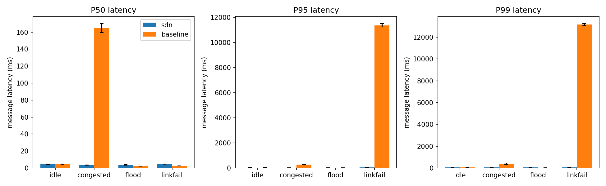
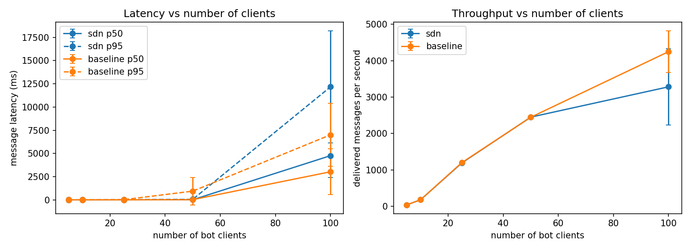
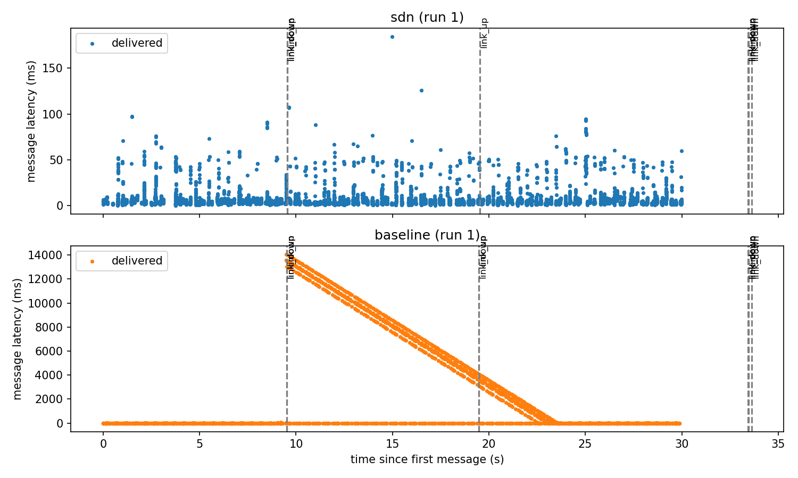
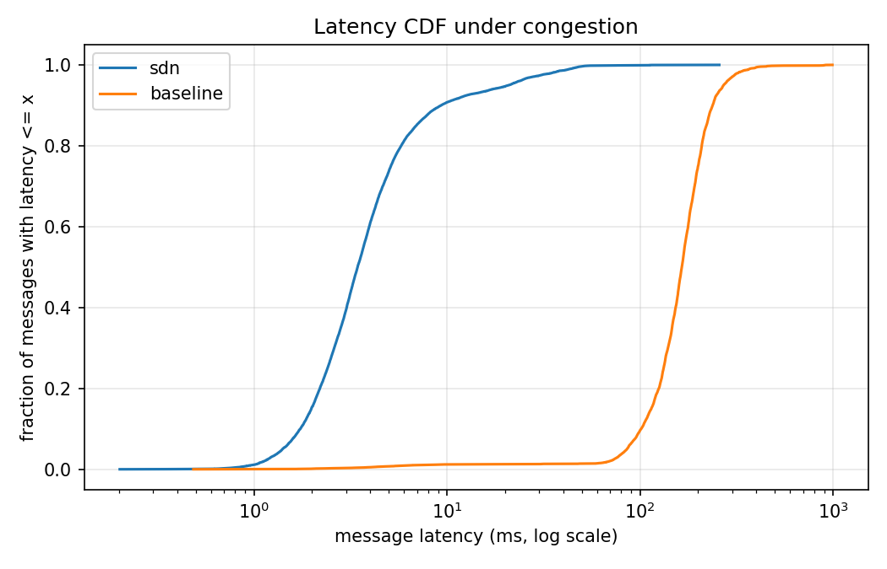

# D2 results: SDN controller vs static baseline

All numbers come from `eval/results/summary.csv` (made by `make report` from the runs under `eval/results/<mode>/<scenario>/`).

## Setup

- **Topology:** the three-switch triangle (s1, s2, s3), 100 Mbps links, a 10 Mbps bottleneck on the port to the chat server (h1) with four HTB queues.
- **Modes:** `sdn` is the full controller (gating, queues, heavy-hitter meter, throttling, rerouting). `baseline` is the same controller code with only static shortest-path forwarding. Same topology and same queues; only `CONTROLLER_MODE` differs.
- **Load:** 10 bots spread over h2, h3 and h4, 2 messages per second each, 30 seconds per run, one shared room. Scale runs use 5 to 100 bots; at 50 and 100 bots the rate is lowered to 1 and 0.5 messages per second per bot so the VM can keep up.
- **Runs:** 3 per mode for every scenario.
- **Metric:** message latency = time received minus time sent, in milliseconds (p50, p95, p99). Loss is the share of expected deliveries that never arrived.
- **Runner:** `eval/run_experiments.py` (restarts the controller, builds the topology, runs the bots, collects the CSV and the controller log for every run).

## Results

| Scenario | Mode | p50 (ms) | p95 (ms) | p99 (ms) | Loss % |
|---|---|---|---|---|---|
| idle | sdn | 4.34 | 29.1 | 53.7 | 0.0 |
| idle | baseline | 4.42 | 24.8 | 57.0 | 0.0 |
| congested | sdn | 3.46 | 19.7 | 40.6 | 0.0 |
| congested | baseline | 164.8 | 270.4 | 376.9 | 0.0 |
| flood | sdn | 3.60 | 24.2 | 49.3 | 0.0 |
| flood | baseline | 2.06 | 17.2 | 36.6 | 0.0 |
| linkfail | sdn | 4.25 | 35.0 | 68.1 | 0.0 |
| linkfail | baseline | 2.47 | 11355.0 | 13155.6 | 0.0 |

Scalability (3 runs per mode at every size; mean of the runs):

| Bots | Runs | sdn: p50 / p95 (ms), loss % | baseline: p50 / p95 (ms), loss % |
|---|---|---|---|
| 5 | 3 | 1.75 / 10.0, 0.0 | 1.72 / 6.86, 0.0 |
| 10 | 3 | 2.32 / 8.06, 0.0 | 2.35 / 11.2, 0.0 |
| 25 | 3 | 3.73 / 18.4, 0.0 | 4.11 / 20.6, 0.0 |
| 50 | 3 | 11.3 / 54.9, 0.0 | 21.2 / 938.6, 0.25 |
| 100 | 3 | 4757 / 12169, 33.8 | 3024 / 7002, 14.3 |

Per run at 50 and 100 bots (p50 / p95 in ms, loss %):

| Bots | Run | sdn | baseline |
|---|---|---|---|
| 50 | 1 | 9.8 / 55.0, 0.0 | 34.8 / 2646.5, 0.75 |
| 50 | 2 | 8.1 / 40.1, 0.0 | 15.3 / 86.4, 0.0 |
| 50 | 3 | 16.1 / 69.7, 0.0 | 13.5 / 82.8, 0.0 |
| 100 | 1 | 2177 / 7797, 20.1 | 5127 / 9255, 21.5 |
| 100 | 2 | 5389 / 9651, 23.0 | 3650 / 8628, 20.6 |
| 100 | 3 | 6705 / 19059, 58.2 | 295 / 3124, 1.0 |

## What the results show

- **Idle:** the two modes are equal within run-to-run noise, so the controller adds no measurable cost when nothing is wrong.
- **Congestion:** a 12 Mbps UDP stream into the 10 Mbps bottleneck fills the link. In baseline every message queues behind it (median 165 ms). With SDN the chat traffic sits in its own queue and the heavy stream is limited by a meter, so the median stays at 3.5 ms: about 48 times lower at p50, 14 times at p95 and 9 times at p99.
- **Link failure:** the link s1-s2 goes down at 10 s and returns at 20 s. In baseline the switches keep sending into the dead link, so messages wait until it returns and the tail latency reaches about 11 s. With SDN the controller sees the port go down, deletes the routes and relearns them over the other path, so p95 stays at 35 ms. No messages are lost in either mode because TCP retransmits; the cost is delay.
- **Flood:** one spammer sending 200 messages per second on its own host. SDN did not improve latency here; baseline was slightly faster. A likely reason (not tested separately): spam messages are tiny, so their bandwidth is small next to the 10 Mbps bottleneck and the cost lands on the chat server's CPU, which throttling at the switch cannot relieve. The SDN run also pays a small cost to flag the user and install the throttle rules.
- **Scalability:** up to 25 bots the two modes are the same. At 50 bots SDN stays steady (p95 40 to 70 ms in all three runs). Baseline matches it in two runs (p95 about 85 ms) and has one bad run (p95 2.6 s, 0.75% loss), which is what makes its mean look much worse; we treat that as an outlier, not as an SDN advantage. At 100 bots both modes are overloaded: median latency is seconds and 20 to 58% of messages are lost in most runs, and the runs differ a lot (baseline run 3 was fine, with a median of 295 ms and 1% loss). All three SDN runs were bad at 100 bots, but with three runs and this spread we do not claim SDN is worse. A likely cause, not tested, is the CPU of the VM and the single-process Python chat server, which sends every message to 99 receivers; that limit is in the server and the VM, not in the network. On this VM the setup saturates somewhere between 50 and 100 bots.

## Spread and reaction times

Mean ± standard deviation over the runs of each scenario (from `summary.csv`):

| Scenario | Mode | Runs | p50 (ms) | p95 (ms) |
|---|---|---|---|---|
| idle | sdn | 3 | 4.3 ± 0.2 | 29.1 ± 14.4 |
| idle | baseline | 3 | 4.4 ± 0.2 | 24.8 ± 11.8 |
| congested | sdn | 3 | 3.5 ± 0.3 | 19.7 ± 7.3 |
| congested | baseline | 3 | 164.8 ± 5.2 | 270.4 ± 17.0 |
| flood | sdn | 3 | 3.6 ± 0.3 | 24.2 ± 3.9 |
| flood | baseline | 3 | 2.1 ± 0.0 | 17.2 ± 10.7 |
| linkfail | sdn | 3 | 4.3 ± 0.5 | 35.0 ± 5.3 |
| linkfail | baseline | 3 | 2.5 ± 0.1 | 11355.0 ± 134.7 |
| scale50 | sdn | 3 | 11.3 ± 4.2 | 54.9 ± 14.8 |
| scale50 | baseline | 3 | 21.2 ± 11.8 | 938.6 ± 1479.1 |
| scale100 | sdn | 3 | 4756.9 ± 2329.0 | 12168.6 ± 6038.5 |
| scale100 | baseline | 3 | 3023.9 ± 2475.7 | 7002.3 ± 3373.7 |

Controller reaction times for the `sdn` runs, from the controller and runner event logs (`eval/extra_metrics.py`, written to `eval/results/reaction_times.csv`). The baseline has no controller reactions to time.

| Scenario | What is timed | Runs | Mean ± std (ms) |
|---|---|---|---|
| linkfail | link down seen by the controller | 3 | 5.8 ± 0.8 |
| linkfail | new routes installed and confirmed | 3 | 13.5 ± 0.9 |
| linkfail | failover, link cut to routes confirmed | 3 | 16.0 ± 4.9 |
| congested | iperf start to congestion response on | 3 | 8856.5 ± 5547.5 |

- **Failover:** the controller sees the port go down within a few milliseconds and has the new routes installed and confirmed in tens of milliseconds, so the path is repaired long before the 10 s the baseline waits for the link to return. Times start when the runner's link-down command returns, so the few milliseconds the command itself takes are not included.
- **Congestion:** the monitor polls once per second and needs two samples above 80% utilization of the bottleneck, so a few seconds is the minimum. The measured mean is longer and varies a lot between runs; we did not investigate the extra delay (the iperf ramp-up is one possible part). By design the queue assignment for chat traffic is installed when a user registers, so it does not wait for this detector; the detector adds the heavy-hitter meter. We did not test that split separately.

## Limits

- All measurements are on a virtual machine, so absolute numbers depend on its CPU and timing; the comparison between modes is the useful result.
- Rules are per host IP, so a flag throttles every user on that host. The flood scenario therefore puts the spammer alone on h4.
- Three runs per mode is a small sample; at 100 bots the runs differ so much that the average is not reliable.

## Reproduce

Run these from the repo root:

    sudo env PYTHONPATH=. python3 eval/run_experiments.py --core --runs 3
    sudo env PYTHONPATH=. python3 eval/run_experiments.py --only scale5,scale10,scale25 --runs 1
    sudo env PYTHONPATH=. python3 eval/run_experiments.py --only scale50,scale100 --runs 3
    make report
